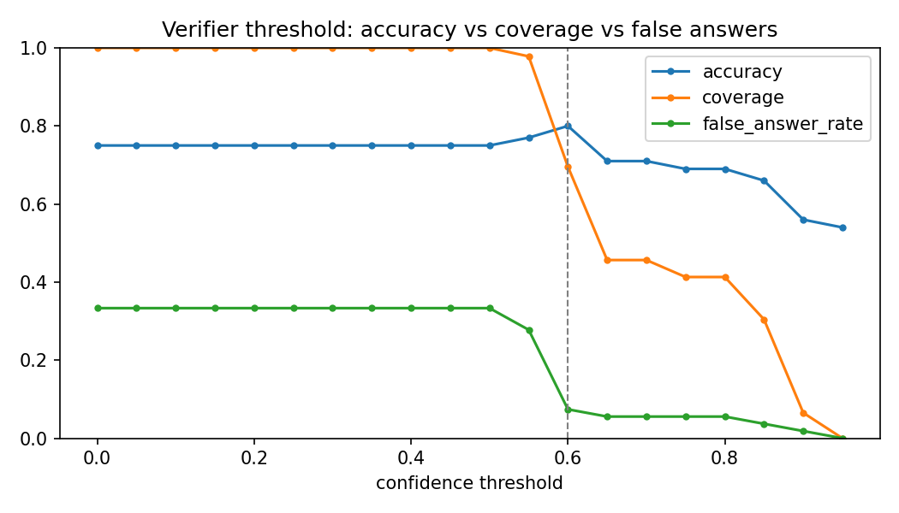
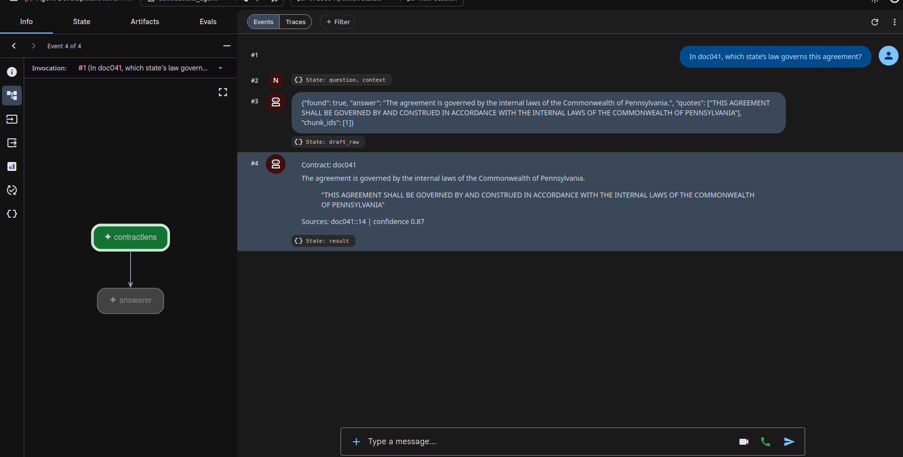
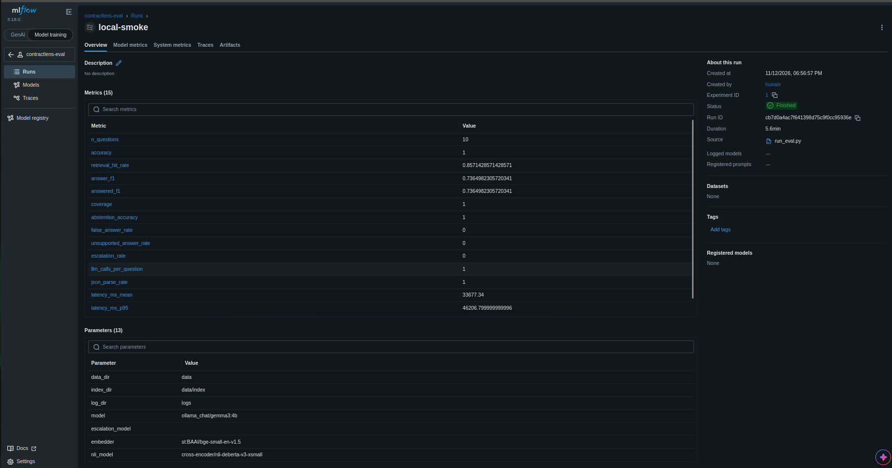
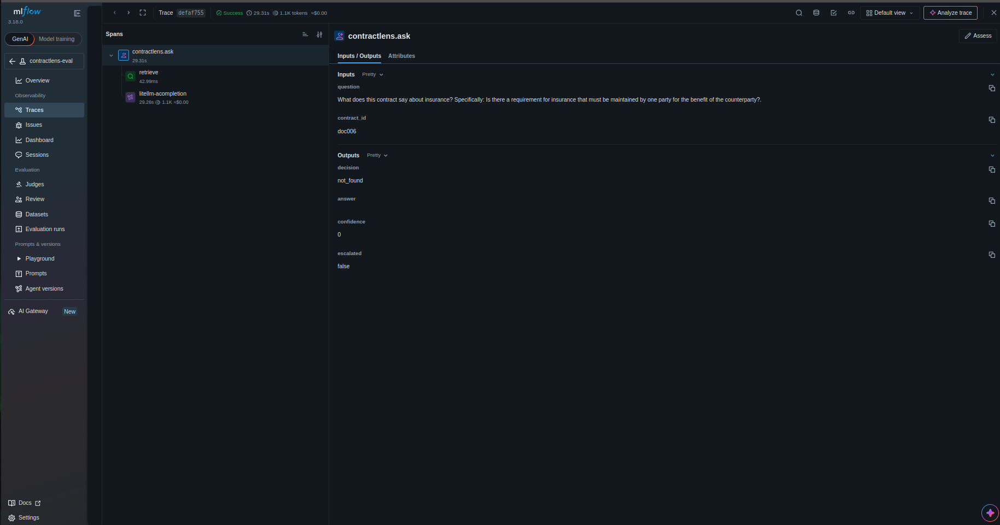

# ContractLens

Grounded, self-verifying contract review agents built with **Google ADK** and **Gemma**, evaluated on real commercial contracts and tracked with **MLflow**.

ContractLens answers questions about a contract ("Can either party terminate for convenience?", "Is liability capped?") with verbatim, cited clauses. A verifier agent checks every answer before it is returned. Answers that fail verification are escalated to a stronger model or withheld, so the system says "insufficient evidence" instead of hallucinating.

## Architecture

```
            ┌──────────────── ADK root agent: ContractLensAgent ────────────────┐
question ──►│ retrieve ──► answerer (LlmAgent) ──► verifier ──► decision        │──► answer + citations
            │ hybrid       Gemma 3 4B via        quote check     ≥ τ  answered  │    + confidence
            │ BM25+dense   Ollama, JSON mode     NLI entailment  < τ  escalate ─┼──► escalator (Gemma 12B / Gemini)
            │ RRF fusion                         Q-evidence rel.      or abstain│
            └───────────────────────────────────────────────────────────────────┘
                     │                                      │
          contracts ─┘ PDF parser (PyMuPDF | Document AI)   └─► MLflow traces, metrics ─► BigQuery
```

| Component | Implementation |
|---|---|
| Agent framework | Google ADK: custom `BaseAgent` orchestrator with `LlmAgent` sub-agents, session state, `adk web` UI |
| LLMs | Gemma 3 4B (answerer) and Gemma 3 12B (escalation) via Ollama; any Gemini model via `CL_MODEL=gemini-2.5-flash` |
| Retrieval | Hybrid BM25 + `bge-small-en-v1.5` dense retrieval, reciprocal rank fusion, per-contract filtering |
| Grounding | Prompted for verbatim quotes, quotes fuzzy-matched against retrieved text, page/offset citations |
| Verification | Weighted confidence from quote support, NLI entailment (`nli-deberta-v3-xsmall`), question–evidence relevance |
| Evaluation | CUAD lawyer-labelled spans: retrieval hit rate, token F1, coverage, abstention accuracy, false-answer rate, latency |
| Experiment tracking | MLflow runs (params, metrics, prompt versions, per-question artifacts), MLflow tracing, threshold-sweep curves |
| Serving | FastAPI (`/ask`, `/contracts` PDF upload, `/health`), Docker image compatible with Cloud Run |
| Analytics | Evaluation results and request logs batch-loaded into BigQuery (free sandbox), SQL in `sql/analysis.sql` |

## Results

Evaluation set: 10 CUAD contracts × 10 clause categories = 100 questions. 46 have an answer in the contract and 54 do not, so the false-answer rate directly measures hallucination. Models ran locally through Ollama on a Kaggle T4 GPU.

| Run | Accuracy | False-answer rate | Coverage | Answer F1 | Retrieval hit | Latency / question |
|---|---|---|---|---|---|---|
| v1 prompt, no verifier (baseline) | 73% | 37.0% | 95.7% | 0.73 | 84.8% | 3.7 s |
| v2 prompt, no verifier | 75% | 33.3% | 100% | 0.65 | 84.8% | 2.9 s |
| **v2 prompt + verifier** | **81%** | **7.4%** | 71.7% | 0.54 | 84.8% | 2.9 s |
| v2 prompt + verifier + Gemma 12B escalation | 81% | 14.8% | 80.4% | 0.61 | 84.8% | 5.6 s |

*Accuracy* counts an answerable question as correct when the quoted clause reaches token F1 ≥ 0.3 against the lawyer-labelled span, and an unanswerable question as correct when the system declines. *False-answer rate* is the share of unanswerable questions that still received an answer. *Coverage* is the share of answerable questions that were answered.

**Findings**

- **The verifier is the main gain.** With the same prompt, it cut false answers from 33.3% to 7.4% (18 to 4 of 54) and raised accuracy from 75% to 81%. The cost is coverage: it withholds 28% of answerable questions, the intended trade-off when a wrong answer is worse than none.
- **Escalation trades safety back for coverage.** Sending low-confidence answers to Gemma 12B recovered coverage (71.7% to 80.4%) and F1, but the larger model answered more unanswerable questions (false answers 7.4% to 14.8%) and doubled latency. A bigger model was more willing to answer, not more cautious.
- **Prompt v2 improved safety, not overlap.** Requiring short verbatim quotes reduced false answers (37.0% to 33.3%), but lowered F1 (0.73 to 0.65) because CUAD gold spans are often whole clauses and shorter quotes match them less fully.
- **Retrieval is the ceiling.** 84.8% of answerable questions had the gold clause in the top-4 chunks; the remaining misses cannot be fixed by the answering or verification stages.
- **Quotes are faithful.** In the verifier run, 2.7% of accepted answers contained a quote not found in the retrieved text (6.7% with 12B escalation).

**Choosing the threshold.** The sweep re-scores one run at every threshold without new model calls. Accuracy peaks at 0.6; above 0.65 coverage drops sharply for little additional safety.



Reproduce with `notebooks/kaggle_eval.ipynb`, then `python scripts/compare_runs.py` and `python scripts/threshold_sweep.py results/gemma4b-v2-prompt.csv`. Results are from a 100-question subset; with 46 answerable questions, each question moves coverage by about 2 points.

## Screenshots

**Agent answering from a single contract with a verbatim, cited clause (Google ADK web UI)**



**Evaluation run tracked in MLflow**



**MLflow trace of one question: retrieve, then answer, then verify**



## Quickstart

```bash
pip install -e ".[dev]"

ollama pull gemma3:4b
export OLLAMA_CONTEXT_LENGTH=8192   # set before `ollama serve`

python scripts/prepare_data.py --n-contracts 10
python scripts/build_index.py
python scripts/ask.py "Is there a cap on liability?" --contract-id doc041

python scripts/run_eval.py --run-name gemma4b-v2-verifier --trace
mlflow ui --backend-store-uri sqlite:///mlflow.db
```

Without a GPU, `notebooks/kaggle_eval.ipynb` runs all experiments on a free Kaggle or Colab T4.

### Agent UI

```bash
adk web agents
```

### API

```bash
uvicorn service.app:app --port 8080
curl -X POST localhost:8080/ask -H "Content-Type: application/json" \
  -d '{"question": "Which law governs this agreement?", "contract_id": "doc041"}'
curl -X POST localhost:8080/contracts -F "file=@my_contract.pdf"
```

### Docker

```bash
docker build -t contractlens .
docker run -p 8080:8080 -e OLLAMA_API_BASE=http://host.docker.internal:11434 contractlens
```

### BigQuery

```bash
pip install -e ".[gcp]"
gcloud auth application-default login
python scripts/export_bigquery.py --project <your-project-id>
```

## Configuration

All settings are environment variables (see `.env.example`).

| Variable | Default | Purpose |
|---|---|---|
| `CL_MODEL` | `ollama_chat/gemma3:4b` | Answerer model (`fake` runs offline) |
| `CL_ESCALATION_MODEL` | empty | Second model for low-confidence answers |
| `CL_EMBEDDER` | `st:BAAI/bge-small-en-v1.5` | Dense embedder (`tfidf` runs offline) |
| `CL_NLI_MODEL` | `cross-encoder/nli-deberta-v3-xsmall` | Entailment model (`lexical` runs offline) |
| `CL_PROMPT_VERSION` | `v2` | Prompt template version |
| `CL_TOP_K` | `4` | Retrieved chunks per question |
| `CL_CONFIDENCE_THRESHOLD` | `0.6` | Verifier acceptance threshold |

## Design decisions

- **Retrieval runs outside the LLM.** Small open models have unreliable tool calling, so the orchestrator retrieves deterministically and passes the excerpts through ADK session state. The answer agent only has to read and quote.
- **The verifier checks three things.** Faithful quotes alone do not catch an answer that quotes an irrelevant clause, so confidence combines quote fidelity, entailment and question–evidence relevance.
- **Escalation, not a bigger model everywhere.** Only answers below the threshold go to the larger model, which keeps cost and latency close to the small model's.
- **Evaluation uses CUAD unanswerable questions.** More than half of the questions have no relevant clause, so the false-answer rate measures hallucination directly.

## GCP deployment path

The project runs entirely on local and free resources. The GCP integrations are behind interfaces:

| Local (default) | GCP |
|---|---|
| `LocalPdfParser` (PyMuPDF) | `DocumentAIParser` in `parsing.py` |
| Ollama Gemma | `CL_MODEL=gemini-2.5-flash` (native ADK Gemini) |
| `uvicorn` / Docker | `deploy/cloud_run.sh`, or `adk deploy cloud_run` / `adk deploy agent_engine` for the agent |
| Local MLflow | BigQuery sandbox analytics (works now, no billing needed) |

## Project structure

```
src/contractlens/   config, data (CUAD), parsing, chunking, index, prompts, models,
                    verifier, agents (ADK), pipeline, evaluation, tracking, bq
agents/             ADK entry point for `adk web` / `adk run`
scripts/            prepare_data, build_index, ask, run_eval, threshold_sweep, compare_runs, export_bigquery
service/            FastAPI app
sql/                BigQuery analysis queries
notebooks/          Kaggle / Colab evaluation notebook
tests/              offline tests (fake model, TF-IDF, lexical NLI)
```

## Data

[CUAD v1](https://github.com/TheAtticusProject/cuad) (Contract Understanding Atticus Dataset), CC BY 4.0: 510 commercial contracts with expert annotations across 41 clause categories.
